# Healthcare Operations & Claims Intelligence

[](https://www.r-project.org/)
[](https://posit.co/)
[](https://ggplot2.tidyverse.org/)
[-green.svg)](https://www.hhs.gov/hipaa/for-professionals/privacy/special-topics/de-identification/index.html)
[](https://opensource.org/licenses/MIT)

An end-to-end healthcare operations, claims analytics, and process re-engineering project examining **all-payer reimbursement disparities**, **prior authorization (PA) lead times**, **upstream clinical documentation bottlenecks**, and **claim denial resolution strategies**.

Developed by **Asef Haque** (MSBA, Brandeis University | BA Psychology, Temple University), bridging healthcare systems analysis, reimbursement economics, and continuous improvement frameworks.

---

### ⚡ Executive Summary for Hiring Managers (15-Second Overview)

| Analytical Pillar | Operational Problem Solved | Key Frameworks & Technical Methods |
| :--- | :--- | :--- |
| **🏥 All-Payer Claims Profiling** | Quantifying reimbursement disparities across Commercial, Medicare, and Medicaid plans | Cross-tabulation of \$700M+ inpatient claims across 25 Major Diagnostic Categories (`MDC`), spend distributions, and payer mix analysis in R/tidyverse. |
| **⏱️ Prior Auth Lead Time** | Diagnosing root causes of specialty care delays (cutting submission cycle from 5.2 days to < 4 hours) | As-Is vs. To-Be workflow analysis, identifying 3–5 day upstream charting lag among high-volume clinicians as primary constraint. |
| **📊 Continuous Improvement Triage** | Prioritizing technical & operational initiatives against behavioral adoption friction | Explicit prioritization ratio: $\text{Priority} = \frac{\text{Capacity Impact} \times \text{Feasibility}}{\text{Operational Risk}}$, sizing ROI and staffing capacity. |
| **🛡️ Denial Taxonomy & Appeals** | Structuring root-cause triage for payer claim rejections and access friction | Mapping federally standardized Claim Adjustment Reason Codes (**CARC 197** missing auth, **CARC 50** medical necessity, **CARC 16** missing docs) against appeal overturn rates. |

---

## 📊 Visual Gallery & Operational Dashboards

### 1. All-Payer Inpatient Spend Across Top Major Diagnostic Categories
> Commercial payers account for major volume in working-age orthopedic procedures (Musculoskeletal: \$88M), while Medicare covers the vast majority of cardiovascular and geriatric inpatient admissions (Circulatory: \$136M).


---

### 2. Prior Authorization Lead Time: Upstream Documentation Lag vs. Optimized Target
> Process analysis reveals the prior auth team is not slow at portal entry; they are starved of clinical notes for 3–5 days due to offline batch-charting habits. Deploying pre-assembly and ambient scribing compresses cycle time to < 4 hours.


---

### 3. Operational Triage Framework: Continuous Improvement Priority Ranking
> Ranking initiatives by balancing capacity recapture, technology readiness, and clinical/regulatory risk. High-leverage process fixes (inbox consolidation, SMS outreach) rank higher than brittle robotic automation.


---

### 4. Payer Claim Denial Taxonomy: Root Causes vs. Appeal Overturn Potential
> Analyzing claim denial drivers by CARC category. CARC 16 (Missing Docs) and CARC 197 (Precertification Absent) exhibit the highest appeal overturn success rates (78%–84%) when supported by standardized pre-submission evidence packets.


---

## 🔄 End-to-End Workflow Optimization (As-Is vs. To-Be)

```mermaid
flowchart TD
    subgraph CURRENT_STATE ["Current State: 3 to 5 Day Information Black Hole"]
        A["Clinical Encounter"] --> B{"Clinician Habit"}
        B -->|"Batch-Charting Clinicians"| C["Offline Notes & Weekend Charting\n(3-5 Day Documentation Lag)"]
        B -->|"Same-Day Completers"| D["EHR Chart Closed"]
        C --> E["Procedure / Specialty Order Created"]
        D --> E
        E --> F["Manual Double Entry into Shadow Excel Tracker"]
        F --> G["Staff Discovers Missing Clinical Notes\n(CARC 16 / CARC 197 Denial Risk)"]
        G --> H["Manual Submission into Payer Portal\n(Lead Time: 5.2 Days)"]
    end

    subgraph FUTURE_STATE ["Target State: Streamlined Prior Auth Clearance (< 4 Hours)"]
        I["Clinical Encounter + Ambient Documentation"] --> J["EHR Real-Time Structured Note Closure"]
        J --> K["Automated EHR Intake Queue Integration"]
        K --> L["Prior Auth Pre-Assembly & Medical Necessity Check"]
        L --> M["Licensed Clinician Review & Attestation Gate"]
        M --> N["Payer Submission & Automated SLA Tracking\n(Lead Time: < 4 Hours)"]
    end
```



---

## 🔒 Data Governance & HIPAA Compliance Statement

This repository adheres strictly to federal data privacy regulations, healthcare governance standards, and institutional data use agreements (DUAs):
- **100% De-Identified (HIPAA Safe Harbor Standard, 45 CFR § 164.514):** Zero patient names, medical record numbers (MRNs), dates of birth, social security numbers, geographic identifiers below state level, or specific dates are included.
- **CMS Small-Cell Suppression Rule ($N \ge 11$):** All reported claims and financial distributions represent high-level diagnostic aggregates (thousands of hospital encounters and millions in billed spend).
- **Entity Anonymization:** No proprietary health system names, private fee schedules, or client-confidential operational logs are published. All metrics are presented at the diagnostic category (`MDC`) and standardized code level (`CARC`).

---

## 📁 Repository Architecture

```
Healthcare_Operations_Claims_Intelligence/
├── data/
│   └── aggregated_payer_claims_summary.csv   # Aggregated spend by MDC & payer group (Zero PHI)
├── scripts/
│   ├── generate_dashboard_charts.R           # R / ggplot2 script producing high-res dashboard visuals
│   └── claims_payer_analysis.R               # R/tidyverse claims cross-tabulation and spend pipeline
├── assets/                                   # 0-click visual dashboard figures
│   ├── 01_payer_claims_reimbursement.png
│   ├── 02_prior_auth_turnaround_lag.png
│   ├── 03_continuous_improvement_triage.png
│   └── 04_claim_denial_waterfall.png
├── .gitignore                                # Strict exclusion of raw data files & microdata
└── README.md                                 # Technical documentation and executive case study
```

---

## 👨‍💻 Author

**Asef Haque**  
- MS in Business Analytics | Brandeis University International Business School  
- BA in Psychology (Cognitive/Behavioral) | Temple University  
- Focus: Healthcare Business Analytics, Operations Re-engineering, Payer Reimbursement & Decision Science  
- Contact: asefhaque@brandeis.edu | [LinkedIn](https://www.linkedin.com/in/asefhaque/) | [GitHub](https://github.com/asefhaque)
